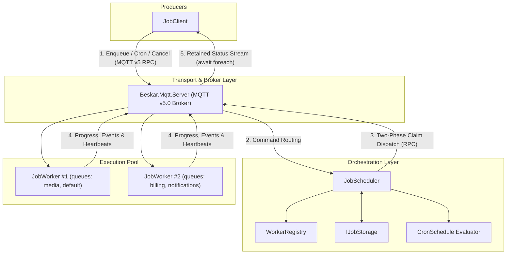
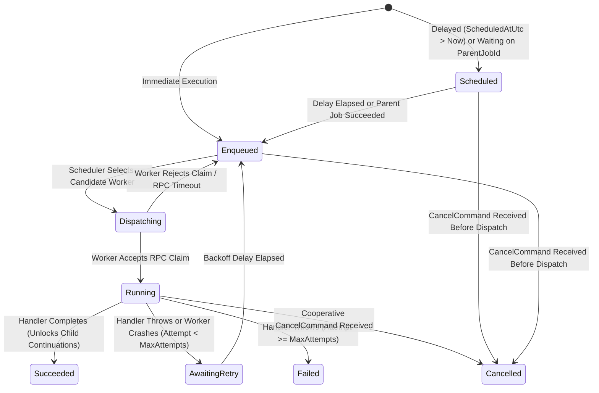

# Distributed Job Scheduling & Execution Overview

The `Beskar.Jobs` suite (`Beskar.Jobs.Common`, `Beskar.Jobs.Client`, `Beskar.Jobs.Worker`, `Beskar.Jobs.Scheduler`, and `Beskar.Jobs.Generator`) provides a high-performance, low-allocation, transport-agnostic **Distributed Background Job Scheduling & Execution Engine** built natively on top of `Beskar.Mqtt` (MQTT v5.0).

Because it layers directly on `Beskar.Mqtt`, your job cluster can communicate over **TCP, TLS, WebSockets, QUIC, Unix Domain Sockets (UDS), Named Pipes, or In-Memory** transports without changing a single line of job or handler code.

---

## 1. Core Capabilities

* **Compile-Time Source Generation (`[GeneratedJobHandler]`)**: Eliminates magic strings for job types and queues via the `BeskarJobGenerator` Roslyn incremental source generator.
* **Zero-Allocation Bitmask Cron & Interval Engine**: Supports 5-field standard Cron, 6-field seconds-precision Cron, standard `@` macros (`@hourly`, `@daily`, `@weekly`, `@monthly`, `@yearly`), and sub-second intervals (`@every 250ms`, `@every 30s`).
* **Real-Time Progress & Result Streaming**: Stream live progress percentages, status messages, and final typed results over MQTT retained topics using `IAsyncEnumerable<JobStatusUpdate>` (`await foreach`).
* **Multi-Stage DAG Continuations**: Chain dependent child and grandchild jobs (`Parent -> Child -> Grandchild`) that automatically unlock and dispatch as soon as their parent job succeeds.
* **Capability-Aware Load Balancing**: Workers advertise their subscribed queues, registered job types, and live concurrency slots via retained heartbeats; the scheduler routes jobs to the lowest-loaded capable worker with round-robin tie-breaking.
* **Automatic Retries & Cooperative Cancellation**: Configurable backoff policies (`ExponentialBackoffPolicy`, `DecorrelatedJitterBackoffV2Policy`, etc.), per-attempt timeouts, and instant cooperative `CancellationToken` propagation across the network.
* **Instant Worker Crash Recovery via MQTT LWT**: Worker nodes register an MQTT v5.0 Last Will and Testament (`IsOnline = false`). If a worker process crashes or loses power mid-job, the broker immediately publishes its Will, and the scheduler automatically recovers and reschedules all orphaned in-flight jobs.
* **Pluggable Persistence (`IJobStorage`)**: Ships with a thread-safe `InMemoryJobStorage` and a clean 10-method async interface ready for PostgreSQL, SQLite, SQL Server, or Redis.

---

## 2. Cluster Architecture & Topology



---

## 3. Job State Machine Lifecycle

Every job instance (`JobInstanceRecord`) transitions deterministically through the following states (`JobStatus`):



---

## 4. MQTT Topic Namespace & Wire Protocol

All topics are compiled at build time using `[GeneratedMqttTopic]` inside [`JobTopics`](https://github.com/MarvinDrude/Beskar.Networking/blob/master/Jobs/Beskar.Jobs.Common/Topics/JobTopics.cs):

| Topic Pattern | Direction | QoS | Retain | Purpose |
| :--- | :--- | :---: | :---: | :--- |
| `jobs/commands/enqueue` | `JobClient` -> `JobScheduler` | QoS 1 | No | MQTT v5.0 Request/Response RPC to enqueue immediate, delayed, or continuation jobs. |
| `jobs/commands/recurring` | `JobClient` -> `JobScheduler` | QoS 1 | No | MQTT v5.0 Request/Response RPC to register or update a recurring Cron/interval schedule. |
| `jobs/commands/cancel/{jobId}` | `JobClient` -> `Scheduler` & `Worker` | QoS 1 | No | Broadcasts a cooperative cancellation command to abort a queued or running job. |
| `jobs/dispatch/{queue}/{workerId}` | `JobScheduler` -> `JobWorker` | QoS 1 | No | Two-phase dispatch claim RPC sent to a specific candidate worker with free capacity. |
| `jobs/events/{jobId}/{eventType}` | `JobWorker` -> `JobScheduler` | QoS 1 | No | Worker lifecycle notifications (`started`, `progress`, `completed`, `failed`, `cancelled`). |
| `jobs/status/{jobId}` | `Scheduler` / `Worker` -> `JobClient` | QoS 1 | **Yes** | Real-time status, progress percentage, and result stream for `WatchJobStatusAsync`. |
| `jobs/workers/{workerId}/heartbeat` | `JobWorker` -> `JobScheduler` | QoS 1 | **Yes** | Worker capacity advertisement (`ActiveJobs`, `MaxConcurrency`, `Queues`, `SupportedJobTypes`) + LWT offline notification. |

---

## 5. End-to-End Quick Start

```csharp
using System.Net;
using Beskar.Jobs.Client;
using Beskar.Jobs.Common.Attributes;
using Beskar.Jobs.Common.Enums;
using Beskar.Jobs.Common.Interfaces;
using Beskar.Jobs.Scheduler;
using Beskar.Jobs.Worker;
using Beskar.Mqtt.Server;

var endPoint = new IPEndPoint(IPAddress.Loopback, 18881);

// 1. Start the MQTT v5.0 Broker
var broker = MqttServerFactory.CreateBuilder()
   .WithDefaultClientIdGenerator()
   .UseTcp(endPoint.Port)
   .Build();
await broker.StartAsync();

// 2. Start the Job Scheduler
await using var scheduler = JobSchedulerBuilder.Create()
   .WithTickInterval(TimeSpan.FromMilliseconds(25))
   .UseTcp(endPoint)
   .Build();
await scheduler.StartAsync();

// 3. Start a Job Worker with a source-generated handler
await using var worker = JobWorkerBuilder.Create()
   .WithWorkerId("worker-01")
   .WithMaxConcurrency(4)
   .RegisterGeneratedHandlerWithResult<ImageResizeJobHandler, ImageResizeArgs, ImageResizeResult>()
   .UseTcp(endPoint)
   .Build();
await worker.StartAsync();

// 4. Connect a Job Client, enqueue a job, and stream live progress
await using var client = JobClientBuilder.Create()
   .UseTcp(endPoint)
   .Build();
await client.ConnectAsync();

var enqueueResult = await client.EnqueueGeneratedWithResultAsync<ImageResizeJobHandler, ImageResizeArgs, ImageResizeResult>(
   new ImageResizeArgs("banner.png", 1920, 1080));

var jobId = enqueueResult.Success!.JobId;

await foreach (var update in client.WatchJobStatusAsync(jobId))
{
   Console.WriteLine($"[{update.Status}] {update.ProgressPercent}% - {update.Message}");

   if (update is { Status: JobStatus.Succeeded, ResultPayload: not null })
   {
      var result = client.Options.Serializer.Deserialize<ImageResizeResult>(update.ResultPayload);
      Console.WriteLine($"Output: {result?.OutputPath} ({result?.OutputBytes:N0} bytes)");
   }
}

await broker.StopAsync();

public sealed record ImageResizeArgs(string FileName, int Width, int Height);
public sealed record ImageResizeResult(string OutputPath, long OutputBytes);

[GeneratedJobHandler("media.image.resize", Queue = "media")]
public sealed partial class ImageResizeJobHandler : IJobHandlerWithResult<ImageResizeArgs, ImageResizeResult>
{
   public async ValueTask<ImageResizeResult> ExecuteAsync(
      IJobExecutionContext<ImageResizeArgs> context,
      CancellationToken ct = default)
   {
      await context.ReportProgressAsync(50, $"Resizing {context.Arguments.FileName}...", ct);
      await Task.Delay(100, ct);
      return new ImageResizeResult($"/cdn/{context.Arguments.FileName}.webp", 148_920);
   }
}
```

---

## 6. Further Reading

- [Job Handlers, Source Generator & Progress Streaming](https://github.com/MarvinDrude/Beskar.Networking/blob/master/Documentation/Jobs/HandlersAndSourceGenerator.md)
- [Cron Scheduling & DAG Continuation Workflows](https://github.com/MarvinDrude/Beskar.Networking/blob/master/Documentation/Jobs/SchedulingAndWorkflows.md)
- [Worker Routing, Retries, Cancellation & LWT Failover](https://github.com/MarvinDrude/Beskar.Networking/blob/master/Documentation/Jobs/WorkerRoutingAndResilience.md)
- [Storage & Custom Database Persistence](https://github.com/MarvinDrude/Beskar.Networking/blob/master/Documentation/Jobs/StorageAndPersistence.md)
