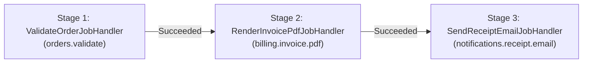

# Cron Scheduling & DAG Continuation Workflows

`Beskar.Jobs` includes a zero-allocation bitmask Cron and interval evaluator ([`CronSchedule`](https://github.com/MarvinDrude/Beskar.Networking/blob/master/Jobs/Beskar.Jobs.Common/Scheduling/CronSchedule.cs)), delayed scheduling, and multi-stage parent-to-child Directed Acyclic Graph (DAG) continuations.

---

## 1. Zero-Allocation Bitmask Cron & Interval Engine (`CronSchedule`)

`CronSchedule` parses Cron expressions and `@every` intervals using `ReadOnlySpan<char>` slicing and compiles them into a compact `readonly struct` containing six `ulong`/`uint` bitmasks:

* `SecondsMask` (`ulong` — bits `0..59`)
* `MinutesMask` (`ulong` — bits `0..59`)
* `HoursMask` (`uint` — bits `0..23`)
* `DaysOfMonthMask` (`uint` — bits `1..31`)
* `MonthsMask` (`ushort` — bits `1..12`)
* `DaysOfWeekMask` (`byte` — bits `0..6`, where `0 = Sunday` and `7` is normalized to `0`)

### Supported Expression Formats

| Format | Example | Meaning |
| :--- | :--- | :--- |
| **5-Field Cron** | `*/15 9-17 * * 1-5` | Every 15 minutes between 09:00 and 17:59, Monday through Friday (`sec = 0`). |
| **6-Field Cron (Seconds)** | `0,30 * * * * *` | At second `0` and `30` of every minute. |
| **Complex Lists & Steps** | `0 1-5,10,20-30/5 * * * *` | Combines ranges (`1-5`), discrete values (`10`), and stepped ranges (`20, 25, 30`). |
| **Macros** | `@yearly`, `@annually`, `@monthly`, `@weekly`, `@daily`, `@midnight`, `@hourly` | Standard Cron shorthand macros. |
| **Sub-Minute Intervals** | `@every 250ms`, `@every 5s`, `@every 15m`, `@every 2h` | Fixed time-delta intervals supporting `ms`, `s`, `m`, and `h` units. |

### Direct `CronSchedule` Evaluation Example

```csharp
using Beskar.Jobs.Common.Scheduling;

// Parse a 6-field Cron expression (or use CronSchedule.TryParse)
var schedule = CronSchedule.Parse("*/10 * * * * *");

var now = new DateTimeOffset(2026, 10, 17, 12, 0, 0, TimeSpan.Zero);
DateTimeOffset? nextRun = schedule.GetNextOccurrence(now);
// nextRun -> 2026-10-17T12:00:10Z
```

---

## 2. Recurring Jobs (`ScheduleRecurringAsync`)

Clients can register or update recurring schedules dynamically at runtime via `JobClient.ScheduleRecurringAsync`:

```csharp
using Beskar.Jobs.Common.Enums;

var response = await client.ScheduleRecurringAsync(
   recurringJobId: "nightly-ledger-reconciliation",
   cronExpression: "0 0 2 * * *", // Every day at 02:00:00 UTC
   jobType: "finance.ledger.reconcile",
   args: new LedgerReconcileArgs(IncludePendingSettlements: true),
   queue: "finance",
   misfirePolicy: MisfirePolicy.FireOnceNow,
   overlapPolicy: OverlapPolicy.SkipIfRunning,
   maxAttempts: 3,
   timeout: TimeSpan.FromMinutes(10));

Console.WriteLine($"Next execution scheduled for: {response.Success!.NextRunAtUtc:O}");
```

### Overlap Policies (`OverlapPolicy`)
Controls what happens when a Cron schedule triggers while the *previous* job instance spawned by that same recurring schedule is still active (`Enqueued`, `Dispatching`, or `Running`):

| Policy | Value | Behavior |
| :--- | :---: | :--- |
| **`AllowConcurrent`** | `0` | Spawns a new job instance immediately alongside the still-running previous instance. |
| **`SkipIfRunning`** | `1` | *(Default)* Skips spawning a duplicate instance and advances `NextRunAtUtc` to the next future occurrence. |
| **`QueueNext`** | `2` | Enqueues the new instance as a child continuation (`ParentJobId = LastJobInstanceId`) so it runs immediately after the active run finishes. |

---

## 3. Delayed Execution (`delay`)

To schedule a one-off job to run in the future, pass the `delay` parameter to `EnqueueAsync` or `EnqueueGeneratedAsync`:

```csharp
// Remains in JobStatus.Scheduled until 15 minutes have elapsed, then transitions to Enqueued
var delayed = await client.EnqueueGeneratedAsync<SendTrialExpiryReminderHandler, ReminderArgs>(
   new ReminderArgs(UserId: "usr_8821"),
   delay: TimeSpan.FromMinutes(15));
```

---

## 4. Multi-Stage DAG Continuations (`Parent -> Child -> Grandchild`)

Continuation jobs allow you to build multi-stage workflows where a child job is held in `JobStatus.Scheduled` (`ParentJobId != null`) until its parent job transitions to `JobStatus.Succeeded`.



### Chaining Source-Generated Handlers

Using `EnqueueGeneratedWithResultAsync`, `EnqueueGeneratedContinuationWithResultAsync`, and `EnqueueGeneratedContinuationAsync`, you can chain strongly-typed handlers across different queues without any string literals:

```csharp
var orderArgs = new OrderWorkflowArgs("ORD-2026-9941", "customer@beskar.dev", TotalCents: 49_900);

// Stage 1: Parent job on queue "orders"
var stage1 = (await client.EnqueueGeneratedWithResultAsync<
   ValidateOrderJobHandler,
   OrderWorkflowArgs,
   OrderValidationResult>(orderArgs)).Success!;

// Stage 2: Child continuation on queue "billing" (runs automatically after stage1 succeeds)
var stage2 = (await client.EnqueueGeneratedContinuationWithResultAsync<
   RenderInvoicePdfJobHandler,
   OrderWorkflowArgs,
   InvoicePdfResult>(
      parentJobId: stage1.JobId,
      args: orderArgs)).Success!;

// Stage 3: Grandchild continuation on queue "notifications" (runs automatically after stage2 succeeds)
var stage3 = (await client.EnqueueGeneratedContinuationAsync<
   SendReceiptEmailJobHandler,
   OrderWorkflowArgs>(
      parentJobId: stage2.JobId,
      args: orderArgs)).Success!;

// Wait for the final stage of the pipeline to complete
var finalStatus = await client.WaitForJobCompletionAsync(stage3.JobId, TimeSpan.FromSeconds(15));
```

### Fan-Out Continuations (1 Parent -> N Children)
Multiple child jobs can specify the same `parentJobId`. As soon as the parent job succeeds, `JobScheduler` invokes `IJobStorage.GetContinuationJobsAsync(parentJobId)` and unlocks **all** dependent children in parallel so they can be dispatched concurrently across your worker pool. If the parent job instead terminates with `DeadLettered` or `Cancelled`, all dependent continuation jobs in the chain are automatically cascaded to `JobStatus.Cancelled`.
