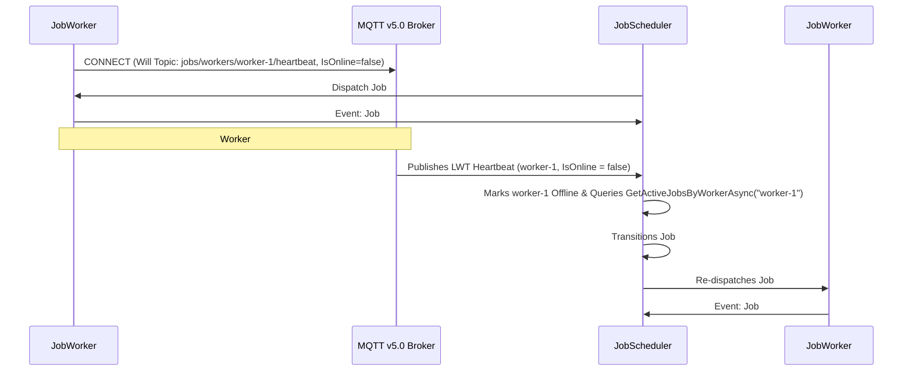

# Worker Routing, Retries, Cancellation & LWT Failover

This guide details how `JobScheduler` selects workers, balances load across queues, executes automatic backoff retries, propagates cooperative cancellations, and recovers orphaned jobs when a worker crashes.

---

## 1. Worker Selection & Load-Balancing Algorithm

Worker routing is coordinated between [`WorkerRegistry`](https://github.com/MarvinDrude/Beskar.Networking/blob/master/Jobs/Beskar.Jobs.Scheduler/Internal/WorkerRegistry.cs) and [`JobScheduler`](https://github.com/MarvinDrude/Beskar.Networking/blob/master/Jobs/Beskar.Jobs.Scheduler/JobScheduler.cs):

### Step 1: Retained Heartbeat Capability Advertisement
Every `JobWorker` periodically publishes a retained `WorkerHeartbeatPayload` to `jobs/workers/{workerId}/heartbeat` containing:
* `IsOnline`: `true` while active, `false` on graceful disconnect or ungraceful MQTT LWT trigger.
* `Queues`: Subscribed queue names (e.g., `["media", "ops"]`).
* `SupportedJobTypes`: Registered handler job types (e.g., `["media.video.transcode", "media.video.thumbnail"]`).
* `ActiveJobs` & `MaxConcurrency`: Current in-flight job count and maximum concurrency slots.

### Step 2: 4-Stage Eligibility Filter
When dispatching a job, `WorkerRegistry.SelectCandidateWorkers(queue, jobType)` filters all registered workers down to those satisfying:
1. **`IsOnline == true`**
2. **`AvailableSlots > 0`** ($\text{MaxConcurrency} - \text{ActiveJobs} > 0$)
3. **Queue Subscription Match**: `worker.Queues.Contains(job.Queue)`
4. **Handler Capability Match**: `worker.SupportedJobTypes.Contains(job.JobType)`

### Step 3: Load-Factor Sorting & Round-Robin Tie-Breaking
Eligible workers are ranked by:
1. **Lowest Load Factor first**:
   $$\text{LoadFactor} = \frac{\text{ActiveJobs}}{\text{MaxConcurrency}}$$
   A worker running `1/4` jobs ($0.25$) is prioritized ahead of a worker running `1/2` jobs ($0.50$).
2. **Round-Robin Tie-Breaking**:
   When multiple workers share the exact same `LoadFactor` (for example, several idle workers at `0.0`), the registry combines the worker ID's hash with an atomic `_roundRobinCounter` so consecutive jobs are distributed evenly across all idle workers.

### Step 4: Two-Phase MQTT v5.0 RPC Claim & Optimistic Reservation
`JobScheduler` iterates through the ranked candidates and sends a `JobDispatchRequest` over MQTT v5.0 Request/Response (`jobs/dispatch/{queue}/{workerId}`):
* If the worker accepts (`Accepted = true`), the scheduler immediately increments that worker's in-memory `ActiveJobs` count (`IncrementWorkerActiveCount`) so subsequent dispatches in the same tick see the updated load factor immediately.
* If the worker rejects the claim (e.g., its concurrency semaphore filled up a millisecond earlier) or times out, the scheduler automatically falls back to the next candidate worker.

---

## 2. Automatic Retries & Backoff Policies (`RetryPolicy`)

When a job handler throws an unhandled exception (or exceeds its configured `Timeout`), `JobWorker` publishes a `failed` lifecycle event to the scheduler.

* If `Attempt < MaxAttempts`, the job transitions to `JobStatus.AwaitingRetry` and its `ScheduledAtUtc` is set to `UtcNow + RetryPolicy.GetRetryDelay(Attempt)`.
* If `Attempt >= MaxAttempts`, the job transitions to `JobStatus.DeadLettered`, increments the `beskar.jobs.completed` (`status = deadlettered`) metric, fires `JobSchedulerEvents.OnJobDeadLettered`, and cascades `JobStatus.Cancelled` to any dependent continuation jobs.

### Configuring `RetryPolicy`
`RetryPolicy` integrates directly with `Beskar.Networking.Abstractions.Backoffs.IBackoffPolicy`:

```csharp
using Beskar.Jobs.Common.Models;
using Beskar.Jobs.Scheduler;
using Beskar.Networking.Abstractions.Backoffs;

var scheduler = JobSchedulerBuilder.Create()
   .WithRetryPolicy(new RetryPolicy
   {
      MaxAttempts = 5,
      // Built-in policies: ExponentialBackoffPolicy, DecorrelatedJitterBackoffV2Policy, LinearBackoffPolicy, ConstantBackoffPolicy
      Backoff = new ExponentialBackoffPolicy(TimeSpan.FromSeconds(2)),
      MaxDelay = TimeSpan.FromMinutes(1) // Caps exponential growth at 60s
   })
   .UseTcp(endPoint)
   .Build();
```

---

## 3. Cooperative Job Cancellation (`CancelJobAsync`)

Calling `JobClient.CancelJobAsync(jobId, reason)` publishes a `JobCancelCommand` to `jobs/commands/cancel/{jobId}`:

1. **Pre-Execution Cancellation (`Scheduled`, `Enqueued`, `AwaitingRetry`, or `Dispatching`)**:
   `JobScheduler` intercepts the command, transitions the job directly to `JobStatus.Cancelled` in `IJobStorage`, cascades cancellation to any dependent continuation jobs, and broadcasts a terminal retained `JobStatusUpdate` so watching clients unblock immediately.
2. **Mid-Flight Cancellation (`Running`)**:
   The `JobWorker` executing `jobId` receives the command on `jobs/commands/cancel/+`, cancels the per-job `CancellationTokenSource` passed to `ExecuteAsync(context, ct)`, and publishes a `cancelled` event back to the scheduler.

```csharp
await foreach (var update in client.WatchJobStatusAsync(jobId))
{
   if (update is { Status: JobStatus.Running, ProgressPercent: >= 25 })
   {
      await client.CancelJobAsync(jobId, "Cancelled by user request");
   }
}
```

---

## 4. MQTT v5.0 Last Will & Testament (LWT) Crash Recovery

Every `JobWorker` configures an **MQTT v5.0 Will Message** on `jobs/workers/{workerId}/heartbeat` with `IsOnline = false` when connecting to the broker:



---

## 5. Scheduler & Worker Event Pipelines

Both `JobScheduler` and `JobWorker` expose low-allocation `HandlerPipeline<TContext>` event hooks:

### `JobScheduler.Events`
```csharp
scheduler.Events.OnJobEnqueued.Add((ctx, ct) => ValueTask.CompletedTask);
scheduler.Events.OnJobDispatched.Add((ctx, ct) => ValueTask.CompletedTask);
scheduler.Events.OnJobSucceeded.Add((ctx, ct) => ValueTask.CompletedTask);
scheduler.Events.OnJobRetryScheduled.Add((ctx, ct) => ValueTask.CompletedTask);
scheduler.Events.OnJobDeadLettered.Add((ctx, ct) => ValueTask.CompletedTask);
scheduler.Events.OnJobCancelled.Add((ctx, ct) => ValueTask.CompletedTask);
scheduler.Events.OnRecurringJobTriggered.Add((ctx, ct) => ValueTask.CompletedTask);
scheduler.Events.OnWorkerCrashed.Add((ctx, ct) => ValueTask.CompletedTask);
```

### `JobWorker.Events`
```csharp
worker.Events.OnJobStarted.Add((ctx, ct) => ValueTask.CompletedTask);
worker.Events.OnJobCompleted.Add((ctx, ct) => ValueTask.CompletedTask);
worker.Events.OnJobFailed.Add((ctx, ct) => ValueTask.CompletedTask);
worker.Events.OnJobCancelled.Add((ctx, ct) => ValueTask.CompletedTask);
```
